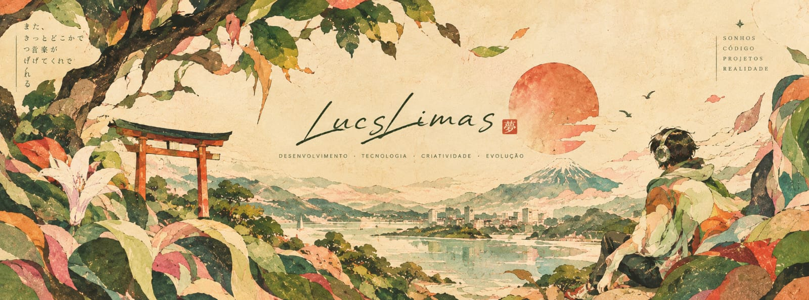

<!--
  LUCAS LIMAS | ORGANIC TECH
  GitHub Profile README
--><!-- BANNER -->

  

<h1 align="center">Olá, eu sou o Lucas</h1>

  <i>Transformando curiosidade em código, ideias em projetos e aprendizado em evolução.</i>

  

---

🍃 Sobre mim

Sou estudante de Análise e Desenvolvimento de Sistemas, apaixonado por tecnologia, música e boas histórias.

Gosto de explorar como a tecnologia pode transformar ideias em soluções reais. Atualmente, estou construindo minha jornada no desenvolvimento de software, aprendendo, experimentando e desenvolvendo projetos acadêmicos e pessoais.

- 🎓 Estudante de Análise e Desenvolvimento de Sistemas.
- 💻 Interessado em desenvolvimento web.
- 🌱 Aprimorando meus conhecimentos em programação e banco de dados.
- 🔍 Explorando lógica, algoritmos e resolução de problemas.
- 🎨 Acredito na conexão entre tecnologia, criatividade e design.

---

🖥️ Tecnologias & ferramentas

  

Atualmente estudando: desenvolvimento web, banco de dados, lógica de programação e boas práticas de desenvolvimento.

---

🌱 Projetos em destaque

<table>
  <tr>
    <td width="50%">
      <h3>◈ Projeto Atlas</h3>
      
Explorando culturas, países e conhecimentos através de uma experiência web.

      

        
        
        
      

      <a href="https://github.com/LucsLimas/Projeto-Atlas">Conhecer projeto →</a>
    </td>
    <td width="50%">
      <h3>◈ Projeto ERP — UPSkill</h3>
      
Modelagem de dados e representação de processos de uma instituição de ensino.

      

        
        
      

      <a href="https://github.com/LucsLimas/Projeto-ERP---UPSkill">Conhecer projeto →</a>
    </td>
  </tr>
</table>---

📊 Estatísticas do GitHub

  
  

  

---

🌿 Minha jornada

  <b>Aprender</b> &nbsp; → &nbsp;
  <b>Experimentar</b> &nbsp; → &nbsp;
  <b>Construir</b> &nbsp; → &nbsp;
  <b>Evoluir</b>

Acredito que cada projeto é uma oportunidade de aprender algo novo. Meu objetivo é desenvolver uma base técnica sólida e construir soluções cada vez melhores.

---

🤝 Vamos nos conectar?

  

  <i>"Grandes jornadas começam com pequenos passos."</i>

  

  Feito com curiosidade, criatividade e muitos commits. 🌱

